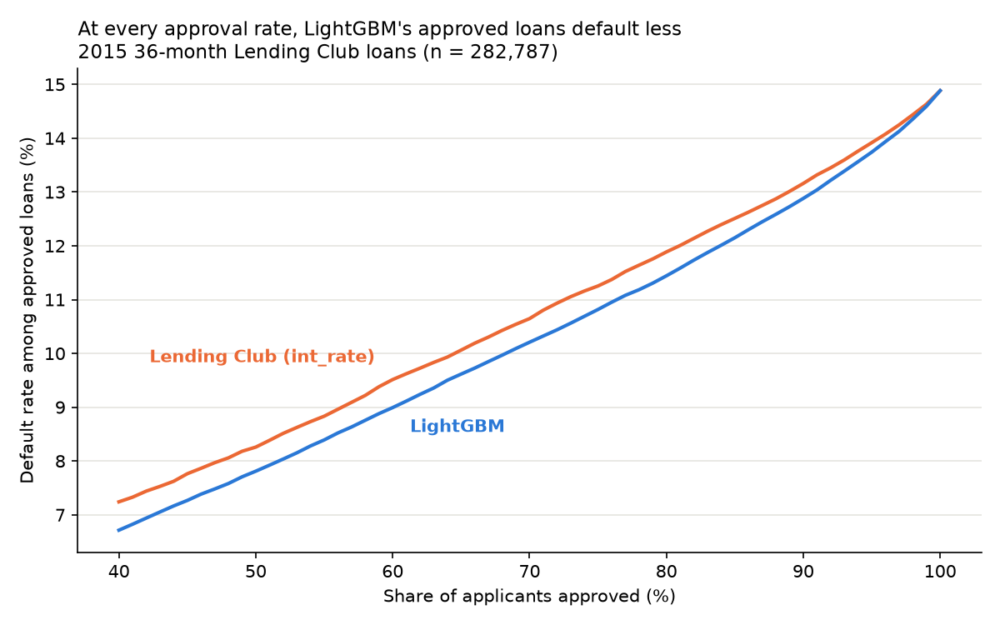

# Outperforming Traditional Credit Grades with Machine Learning

I built a leakage-controlled credit underwriting pipeline using Logistic Regression and LightGBM on 2013–2015 Lending Club 36-month loan data (`n = 282,787` out-of-time 2015 test loans) and found that raw borrower features significantly outperform Lending Club’s proprietary pricing grade (**0.694 vs. 0.679 ROC AUC**).

## Key Results
* **Beats Lending Club’s own grade:** LightGBM’s out-of-time AUC is **0.694** vs. **0.679** for LC’s `sub_grade`, a lift of **+0.016** (95% paired bootstrap CI **[+0.013, +0.018]**). A logistic regression baseline gains **+0.005** (95% CI **[+0.002, +0.007]**), meaning LightGBM delivers more than three times the lift of a linear model.
* **Stable over time:** The lift held in every quarter of 2015 (**+0.014 to +0.017**).
* **More approvals at the same default rate:** Holding portfolio default risk equal to Lending Club's 70% approval cutoff (10.65% default rate), LightGBM expands approvals to **73.67%**—unlocking **+10,389** additional funded loans at the same default rate (or cutting defaults by **about 4%** at the same 70% loan volume).
* **Strong within-grade separation:** Among borrowers whom Lending Club placed in the same `sub_grade`, LightGBM achieves a loan-weighted within-grade AUC of **0.611** (vs. Lending Club's 0.500 random baseline), indicating genuine borrower risk separation across every A–E sub-grade.



## Why This Matters
Traditional credit grades bucket borrowers into coarse risk tiers that leave valuable underwriting signal on the table. This is the core underwriting challenge at lenders like Upstart: modeling borrower features directly captures patterns a 35-level grade misses. This allows a lender to either **approve thousands more borrowers at the same default rate** or **materially reduce defaults at the same origination volume**, while highlighting why production models also require post-hoc calibration to adapt to base-rate shifts.

## Data and Design
* **Loan Universe:** Individual 36-month Lending Club loans originated between 2013 and 2015. Starting in 2013 ensures the extended credit-bureau fields are fully populated; individual applications only, because joint applications began in late 2015. Restricting to 36-month terms ensures every loan had reached full maturity by the end of the archive, avoiding right-censored outcomes.
* **Target Definition:** Binary default (`1` = Charged Off or Default; `0` = Fully Paid). Loans without a final outcome (current, grace period, or late; 147 loans) were excluded.
* **Out-of-Time Split:** To mirror real-world underwriting where models score future applicants, splits are strictly chronological rather than random:

| Split | Issue Period | Loans | Default Rate | Purpose |
| :--- | :--- | :---: | :---: | :--- |
| **Train** | 2013 – Q3 2014 | 212,972 | 12.9% | Fit preprocessing transformations and model parameters |
| **Validation** | Q4 2014 | 50,020 | 14.5% | Early-stopping check for LightGBM |
| **Test** | 2015 | 282,787 | 14.9% | Final out-of-time evaluation |

* **Leakage Rule:** Models only see information known at the moment of application. All post-origination payment fields, bookkeeping dates (`issue_d`, `issue_year`), and Lending Club’s own underwriting outputs (`grade`, `sub_grade`, `int_rate`, `installment`) were excluded. Full column-level audit decisions are documented in [`reports/column_decisions.csv`](reports/column_decisions.csv).
* **Fair-Lending Exclusions:** Geographic fields (`zip_code` and `addr_state`) were excluded prior to modeling to avoid encoding regional or demographic proxies into credit decisions.

## Models
* **Benchmark (Lending Club):** `sub_grade` for AUC; `int_rate` for the approval curve, because 35 grades create large ties when cutting at a percentile.
* **Logistic Regression:** `ColumnTransformer` + `Pipeline` fit strictly on `train`—median imputation with binary missingness indicators and `StandardScaler` for numeric features, plus `"missing"` constant imputation and `OneHotEncoder(handle_unknown="ignore")` for categoricals (`max_iter=1000`).
* **LightGBM:** Gradient boosted decision trees (`learning_rate=0.03`, `num_leaves=31`, `min_child_samples=200`, `subsample=0.8`, `colsample_bytree=0.7`) using native categorical splits and early stopping (`200` rounds) monitored on `valid` AUC.

## Results

### Ranking: Out-of-Time AUC & Paired Bootstrap CI

| Model | Test AUC | Lift vs. LC `sub_grade` | 95% Paired Bootstrap CI |
| :--- | :---: | :---: | :---: |
| LC `sub_grade` (Benchmark) | 0.679 | — | — |
| Logistic Regression | 0.683 | +0.005 | [+0.002, +0.007] |
| **LightGBM** | **0.694** | **+0.016** | **[+0.013, +0.018]** |

*Lifts and confidence intervals are computed from unrounded AUCs, so they may differ by ±0.001 from the difference of the rounded values shown.*

Even a linear model beats Lending Club’s benchmark with statistical confidence, while LightGBM more than triples that ranking lift across 1,000 paired bootstrap resamples (*p* < 0.001).

### Stability by Quarter (2015 Test Set)

| Quarter | Loans | Default Rate | LC `sub_grade` AUC | LogReg AUC | LightGBM AUC | LightGBM Lift |
| :--- | :---: | :---: | :---: | :---: | :---: | :---: |
| Q1 2015 | 56,568 | 14.83% | 0.673 | 0.677 | 0.689 | +0.016 |
| Q2 2015 | 64,222 | 15.38% | 0.677 | 0.681 | 0.691 | +0.014 |
| Q3 2015 | 73,567 | 14.58% | 0.681 | 0.686 | 0.696 | +0.015 |
| Q4 2015 | 88,430 | 14.81% | 0.682 | 0.687 | 0.698 | +0.017 |

LightGBM’s lift over Lending Club held steady between +0.014 and +0.017 in every quarter of 2015, showing that the underwriting signal did not decay over the year.

### Within-Grade Signal

| Model | Loan-Weighted Within-`sub_grade` AUC | A1 AUC (`n = 12,372`) | B3 AUC (`n = 18,501`) |
| :--- | :---: | :---: | :---: |
| LC `sub_grade` (Random Baseline) | 0.500 | 0.500 | 0.500 |
| Logistic Regression | 0.598 | 0.650 | 0.598 |
| **LightGBM** | **0.611** | **0.662** | **0.611** |

Among borrowers whom Lending Club placed into the exact same `sub_grade`, LightGBM still achieves a 0.611 loan-weighted AUC, showing meaningful risk differentiation inside tiers that traditional pricing treats as uniform.

### Approval vs. Default Rate & Same Risk, More Approvals

| Approval Cutoff | LC `int_rate` Default Rate | LightGBM Default Rate | Relative Default Reduction | LightGBM Approval at LC Risk | Extra Loans Funded |
| :---: | :---: | :---: | :---: | :---: | :---: |
| 60% | 9.51% | 8.99% | 5.5% | 64.11% | +11,616 |
| **70%** | **10.65%** | **10.21%** | **4.1%** | **73.67%** | **+10,389** |
| 80% | 11.89% | 11.44% | 3.7% | 83.09% | +8,751 |

At the 70% approval benchmark, switching from Lending Club’s pricing rank to LightGBM either cuts the default rate by about 4% at the same loan volume or expands approvals to 73.7% (+10,389 loans) at the exact same 10.65% default rate.

### Calibration

| Risk Decile | Loans | Avg Predicted Prob | Actual Default Rate | Actual / Predicted |
| :--- | :---: | :---: | :---: | :---: |
| 1 (Lowest Risk) | 28,279 | 3.21% | 2.95% | 0.92 |
| 2 | 28,279 | 5.45% | 5.76% | 1.06 |
| 3 | 28,278 | 7.22% | 7.82% | 1.08 |
| 4 | 28,279 | 8.96% | 10.33% | 1.15 |
| 5 | 28,279 | 10.79% | 12.19% | 1.13 |
| 6 | 28,278 | 12.84% | 14.90% | 1.16 |
| 7 | 28,279 | 15.24% | 17.50% | 1.15 |
| 8 | 28,278 | 18.25% | 20.08% | 1.10 |
| 9 | 28,279 | 22.53% | 24.39% | 1.08 |
| 10 (Highest Risk) | 28,279 | 31.73% | 32.91% | 1.04 |
| **Overall Portfolio** | **282,787** | **13.62%** | **14.88%** | **1.09** |

Deciles 4–7 are under-predicted by 13–16%; decile 1 is slightly over-predicted, so the shift came mainly from mid-risk borrowers.

## Limitations and Next Steps
* **Calibration Drift:** While LightGBM ranks borrowers well across deciles, its overall predicted default rate (13.6%) underestimates the realized 2015 default rate (14.9%), reflecting a base-rate shift between the 2013–2014 training period and 2015 originations. In production, periodic post-hoc recalibration (such as Platt scaling or intercept updating on recent matured cohorts) is needed before mapping probabilities to APRs. Recalibration can only correct shifts already observed, so production also needs monthly monitoring of predicted vs. actual.
* **Reject Inference:** The public dataset only contains loans that Lending Club approved and funded. Because performance outcomes are unobserved for rejected applicants, the models are trained and evaluated on a pre-filtered population; applying the model to applicants LC would have declined would require reject-inference adjustments or controlled exploration.
* **Fair-Lending Testing:** While geographic proxies (`zip_code` and `addr_state`) were excluded, the dataset lacks protected-class attributes, preventing formal disparate-impact testing across demographic groups.
* **Single Test Year & Untuned Hyperparameters:** Evaluation covers a single out-of-time year (2015) and uses standard, manually chosen LightGBM hyperparameters; multi-cycle backtesting and systematic hyperparameter tuning are natural next steps.

## How to Reproduce

### 1. Download Data
Download the Lending Club loan dataset (`accepted_2007_to_2018Q4.csv.gz`) from [Kaggle](https://www.kaggle.com/datasets/wordsforthewise/lending-club) and place it in `data/raw/`.

### 2. Set Up Virtual Environment
```bash
cd Upstart_Credit_Risk
python3 -m venv .venv
source .venv/bin/activate
pip install -r requirements.txt
```
*(Note: If LightGBM fails to import on macOS, run `brew install libomp`.)*

### 3. Run Pipeline in Order
```bash
python3 src/01_prepare_data.py          # Filter 2013–2015 36m loans & create chronological splits
python3 src/02_benchmark.py             # Compute baseline AUCs for grade, sub_grade, and int_rate
python3 src/03_logistic_regression.py   # Train & score Logistic Regression pipeline
python3 src/04_lightgbm.py              # Train & score LightGBM with validation early stopping
python3 src/05_bootstrap.py             # Run 1,000-iteration paired bootstrap CIs
python3 src/06_stability.py             # Evaluate quarterly AUC stability across 2015
python3 src/07_within_grade.py          # Compute within-sub-grade AUCs and loan-weighted averages
python3 src/08_approval_curve.py        # Simulate default rates and extra approvals by cutoff
python3 src/09_plot_approval_curve.py   # Generate reports/figures/approval_curve.png
python3 src/10_calibration.py           # Evaluate decile-level probability calibration
```

## Project Structure

```text
Upstart_Credit_Risk/
├── data/
│   ├── raw/          # accepted_2007_to_2018Q4.csv.gz (not committed)
│   └── processed/    # modeling table + saved test predictions (not committed)
├── reports/
│   ├── column_decisions.csv
│   └── figures/approval_curve.png
├── src/              # 01–10 pipeline scripts, run in order
├── requirements.txt
└── README.md
```
